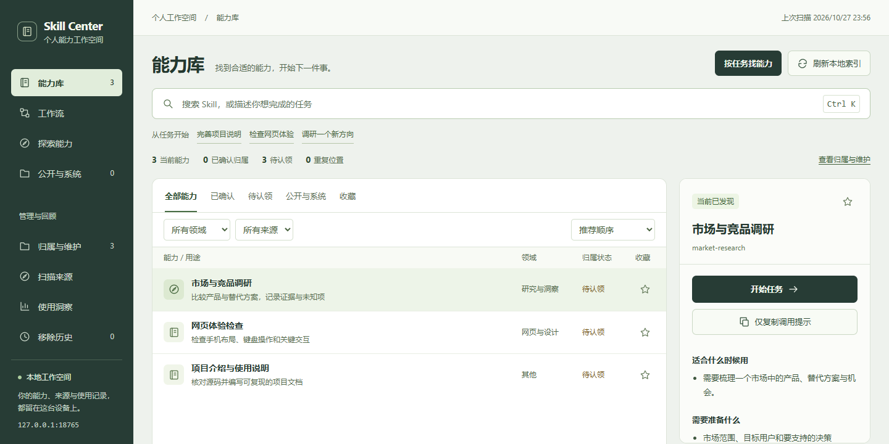
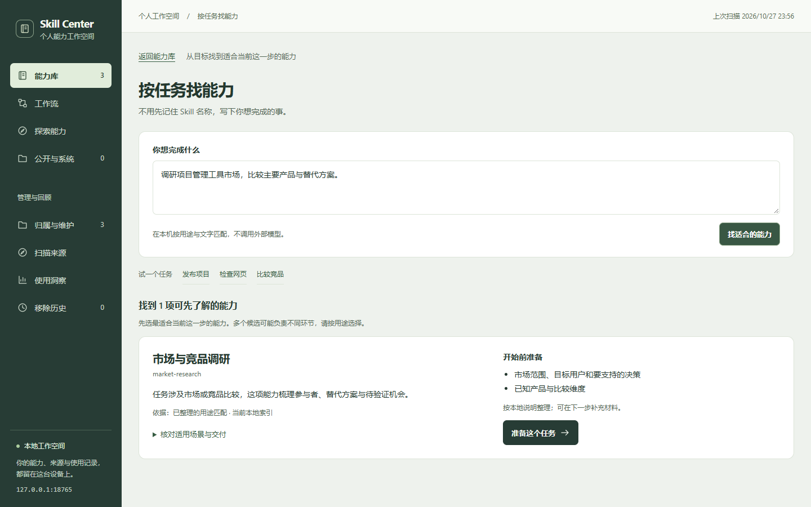
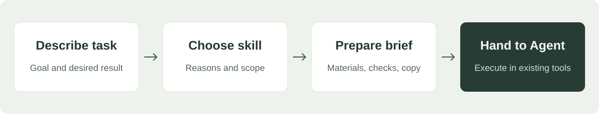

<div align="center">

<h1>Skill Center</h1>

[简体中文](README.md) · **[English](README.en.md)**



<p><strong>A local workbench for finding, understanding, and preparing the Skills you already have installed.</strong></p>

<p><a href="#the-problem">The problem</a> · <a href="#see-it-first">Demo</a> · <a href="#from-goal-to-start">Workflow</a> · <a href="#quick-start">Quick start</a> · <a href="#capabilities-and-boundaries">Boundaries</a> · <a href="CONTRIBUTING.md">Contributing</a></p>

<p><a href="CHANGELOG.md"></a> <a href="requirements.txt"></a> <a href="LICENSE"></a></p>

</div>

> [!NOTE]
> Public alpha `0.1.0-alpha.1`. It is for people who already use Codex Skills and want a clearer local capability library. The interface is currently Chinese-first; the actual task is handed to an existing Agent. A browser walkthrough does not mean that a Skill has already run.

## The problem

Once you have many Skills installed, the hard part becomes remembering what exists, choosing the right capability for the current task, and knowing what material to prepare.

Skill Center brings the inventory, use guidance, and task preparation into one place. You can browse your installed capabilities, describe a task, inspect why a Skill matched, and prepare an execution brief for Codex. It runs locally and does not need a model API key.

## See it first

The repository includes three original examples: project README work, web experience review, and market and competitor research. They are for the first walkthrough and are not exported from the author's private capability library. The number of capabilities shown by the app depends on what you install; it never receives the Skills from the author's computer.

```sh
python scripts/demo.py --open
```

The demo runs in a temporary isolated directory and loads only these three examples. It does not scan your personal directories. The default address is `http://127.0.0.1:8767/my-skills.html`. Keep the terminal open and press Ctrl+C to stop; the demo service and temporary database are then cleaned up. Explicit browser drafts remain in that browser and should be cleared in the interface when needed.



The screenshots above and at the top come from a real isolated demo run. Every displayed entry is an example shipped with this repository.

## From goal to start



1. Select “find by task”; for example, enter “research the market and competitors for project-management tools”.
2. Review the match reasons, suitable situations, and material suggestions. At most three currently discovered capabilities are shown.
3. Select “prepare this task”, then add materials and delivery requirements. Existing drafts are preserved; a new goal must be explicitly adopted.
4. Copy the execution brief into Codex and attach the real materials as needed. The page does not upload files or start execution automatically.

## Quick start

You need **Python 3.10 or newer** and a modern browser. Runtime dependencies use only the Python standard library; `requirements.txt` has no third-party package to install. Windows is locally verified. macOS/Linux use the same Python commands but have not been verified on a real machine yet.

```sh
git clone https://github.com/ZhangShixing0/skill-center.git
cd skill-center
python scripts/skill_center.py start --open
```

On Windows, you can also double-click `open-skill-center.cmd`. On macOS/Linux, replace `python` with `python3` when that is the command on your system.

Then open `http://127.0.0.1:8765/my-skills.html`. The first start scans standard Codex and compatible Agents directories; add project-level directories through “Scan sources”. If no Skill is installed, run the isolated demo first, or install your own Skills and select “Refresh local index”.

```sh
python scripts/skill_center.py doctor
python scripts/skill_center.py status
python scripts/skill_center.py stop
```

If the port is occupied, use `python scripts/skill_center.py start --port 8875 --open`. The launcher performs a local health check before reporting that the service is ready. If something goes wrong, run `doctor` to check Python, the port, and the runtime directory.

By default, data is stored under `Documents/Codex Skill Center` in your home directory. Set `SKILL_CENTER_HOME` to use a separate data directory; configure scan sources from the page. Do not commit the runtime directory to GitHub.

<details>
<summary>Use it as a Skill for Codex</summary>

The repository root `SKILL.md` is the management entry point, named `skill-manager`. To let Codex discover it automatically, clone the whole repository into a personal Skill directory that does not already exist; check an existing same-named directory before changing anything.

```sh
git clone https://github.com/ZhangShixing0/skill-center.git ~/.codex/skills/skill-manager
```

After the current Agent session reloads its capabilities, use `$skill-manager` to request startup, diagnostics, or scanning. Installing this management entry does not install third-party Skills beyond the included examples and does not guarantee that every Agent uses the same discovery mechanism.

</details>

## Capabilities and boundaries

| Capability | Current behavior |
| --- | --- |
| Capability library | Search, classify, filter by source, favorite, and inspect details in place |
| Find by task | Local usage rules plus name/description matching with visible reasons; no model inference |
| Task preparation | Carries in the original goal, creates an editable brief, preserves an explicit draft, and copies or downloads TXT |
| Sources and inventory | Previews scan scope, separates source and authorship, groups duplicate locations, and keeps removed records |
| Versions and review | Tracks observed versions, shows partial differences, and optionally records invocations and feedback |
| Workflows | Shows author-suggested combinations and missing items; never orchestrates execution automatically |

The app listens only on the loopback address. It has no cloud account, team permissions, model recommendations, cross-tool synchronization, or automatic third-party Skill update system. Invocation counts cover only recorded usage; zero records do not prove that nothing was used. Complex or unfamiliar tasks may produce no match; rewrite the goal or browse the capability library directly.

## Security and data

Users and Agents still need to review whether source material and code are safe to execute. A source label is not a security audit. Databases and personal configuration stay in the runtime directory; drafts are saved in the browser only after an explicit action. Check paths and content before sharing diagnostics or screenshots.

See [Security and data boundaries](SECURITY.md), [Architecture and maintenance](docs/architecture.md), and [Sources and licenses](docs/third-party-notices.md).

## Tests and feedback

The repository includes runnable checks for the backend, HTTP boundaries, lifecycle, task matching, and browser flows; commands are listed in [Contributing](CONTRIBUTING.md). Optional browser development dependencies live in `package.json` and do not affect normal application startup.

GitHub Actions is not enabled yet. The repository keeps an [optional CI configuration](docs/ci/verify.yml) for maintainers to activate after obtaining workflow permission; local tests passing does not mean that hosted cross-platform CI has passed.

Useful feedback answers three questions: can a new user install it independently, can they find a suitable capability, and can they prepare their first execution brief? Please include the system and version, reproduction steps, and a reviewed screenshot. Do not upload real databases, tokens, or personal paths. [Open an issue](https://github.com/ZhangShixing0/skill-center/issues).

Future work will prioritize general task matching, version-difference presentation, and first-use guidance based on actual feedback. [CHANGELOG](CHANGELOG.md) describes the current source version and does not promise unimplemented features.

## License

This project and the three included original examples are released under the [MIT License](LICENSE). Skills discovered on your machine remain subject to their own licenses; this repository does not relicense them.
